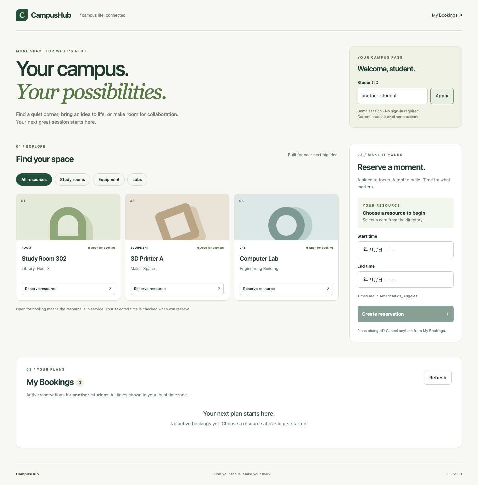

# Lab 5 — UI integration and state audit

Date: 2026-10-26. The automated, browser, and review checks below were run by the coding agent; the student review is recorded at the end.

## Deliverables

- `client/`: React + TypeScript + Vite scaffold with CSS Modules and a committed npm lockfile.
- `client/src/api/campushubApi.ts`: typed `fetchResources(type?)`, `createReservation(CreateReservationDTO)`, `fetchUserReservations(userId)`, and `cancelReservation(reservationId)` methods. Native fetch is explicitly permitted by Part 1. DTOs reuse the contract-aligned shared interfaces through erased type-only imports; no server runtime dependency is bundled.
- `ResourceList.tsx`, `BookingForm.tsx`, `UserReservations.tsx`: the three requested views. Functional components have explicit prop interfaces. Async reads use a reusable hook, and API calls do not appear inside JSX.
- `AGENTS.md`: frontend architecture, state, contract, styling, and verification guidelines.
- `README.md`: fresh-checkout setup, two-terminal startup, test/build commands, and local production preview instructions.

The handout refers to `docs/openapi.yaml`; this repository's authoritative equivalent remains `docs/openapi.json`. No API change was needed. Resources are queried with `isAvailable=true`; availability is administrative and does not promise that a specific time slot is free. The API still returns all user history, while My Bookings filters to PENDING/CONFIRMED as Lab 5 requires. Student IDs are demo identity input, not authentication. Because the client type-imports `src/types/`, it builds inside this repository (or with `src/types/` beside it), not from a copy of `client/` alone.

## Automated checks

| Command                         | Result                                                        |
| ------------------------------- | ------------------------------------------------------------- |
| Root `npm run check`            | Passed strict TypeScript, architecture ESLint, and formatting |
| Root `npm run build`            | Passed                                                        |
| Root `npm test`                 | 24 tests passed, 0 failures                                   |
| `npm --prefix client run check` | Passed TypeScript, typed ESLint, and formatting               |
| `npm --prefix client test`      | 6 tests passed, 0 failures                                    |
| `npm --prefix client run build` | Passed; production assets generated in ignored `client/dist`  |

The frontend tests use Node's built-in runner, with scoped fetch mocks restored after each test. They check exact resource query parameters, writable creation fields, history preservation, bodyless PATCH cancellation, actionable typed conflict errors, and handling of network/non-JSON/malformed/server responses. Browser tests below provide separate real integration evidence; mocked API tests alone are not treated as end-to-end verification.

## Browser integration audit

Used headless Google Chrome through the available Playwright runtime, connecting Vite to the actual Express server and MongoDB replica set. The full workflow passed on the final **production build served by `vite preview`**, not just the development server. A separate `campushub_test_lab5_*` database was seeded for these checks; existing application bookings were not modified.

| Scenario                    | Observed behavior                                                                                                            |
| --------------------------- | ---------------------------------------------------------------------------------------------------------------------------- |
| Directory and type controls | Three in-service seeded resources; ROOM, EQUIPMENT, LAB filters return matching cards; unavailable res-104 omitted           |
| Invalid interval            | End before start shows validation alert, sends no POST                                                                       |
| Reservation creation        | Actual POST returns 201; local 10:00 in Los Angeles converts to 18:00Z in winter; new booking appears in dashboard           |
| In-flight creation          | Reserving indicator visible, submit and student switch disabled, only one request sent                                       |
| Double booking through UI   | Actual backend returns 409; explicit “already reserved for the selected time window” alert; form remains usable              |
| Cancellation error          | Injected 500 leaves booking visible, hides internal details, and re-enables cancellation                                     |
| Successful cancellation     | Actual PATCH returns CANCELLED; refreshed active list removes the booking                                                    |
| Rebooking                   | Same resource and interval can be booked again after cancellation                                                            |
| Reload                      | Booking remains visible after a full page reload                                                                             |
| Student change              | Applying a new valid ID switches to that student's list without retaining another student's bookings                         |
| Directory network error     | Error banner replaces loading; Try again succeeds after network recovery                                                     |
| Malformed success response  | Invalid resource payload produces an error rather than rendering broken cards or crashing                                    |
| Out-of-order requests       | Artificially delayed ROOM response does not overwrite newer LAB results                                                      |
| Responsive layout           | Desktop and 390px mobile layouts reviewed; no horizontal overflow; mobile form and populated dashboard screenshots inspected |
| Browser exceptions          | No uncaught page errors in the completed workflow                                                                            |

Real creation, overlap, cancellation, rebooking, and persistence requests reached the backend. Network failures, invalid payloads, a cancellation 500, and the slow old filter response were deliberately injected in the browser to exercise recovery; these cases are not represented as naturally occurring server failures.

A separate browser check deliberately held a resource request open. The UI left loading and showed a recoverable error after 15.5 seconds; Try again then loaded real resources successfully.

Every request uses a 15-second AbortSignal timeout. Async mutations reset their loading state in `finally`; async reads resolve to either data or an error. Mutations use an immediate ref guard as well as disabled buttons. Stale read responses are ignored on dependency changes or unmount. Student switching is locked during writes to avoid applying a result to another student's view.

## Actual corrections during implementation

1. The initial DTO used an empty extending interface. Typed ESLint rejected it; it was replaced with a shared type alias, preserving the exact request shape without suppressions.
2. Test-only fetch stubs initially used `async` without awaiting. The require-await rule caught this; stubs now return explicit promises.
3. The first filter browser assertion checked a heading that was already on screen, so it ran before the filtered response finished. The test was corrected to wait for the filtered card count; no backend or UI logic was weakened to satisfy it.
4. A delayed Docker image pull recreated the database containers during early browser setup. The interrupted attempt was discarded and the full workflow rerun successfully after services stabilized.

No missing-409-handling incident is invented: explicit conflict handling was included in the first UI implementation and then verified with the real API.

## Review checks

| Check                                                             | Observed result                                                                                                                                                                                                                                                                                                                                         |
| ----------------------------------------------------------------- | ------------------------------------------------------------------------------------------------------------------------------------------------------------------------------------------------------------------------------------------------------------------------------------------------------------------------------------------------------- |
| Backend `check`, `build`, `npm test`, contract lint               | Passed (24 tests, 0 lint errors); backend source and OpenAPI unchanged by Lab 5                                                                                                                                                                                                                                                                         |
| `client/` installed on its own (`cd client && npm ci`)            | Before review: `build` failed with TS2688 (missing `@types/node`) and `check` flagged every file as unformatted. After declaring the tooling and adding `client/.prettierrc.json`: `check`, 6 tests, and `build` pass                                                                                                                                   |
| Independent headless Chrome run against a freshly seeded database | 17 checks passed: in-service directory and type filter; end-before-start blocked with no POST; booking shown by resource name; UI double booking shows the 409 alert and keeps the form usable; cancel, rebook, reload; student switch and invalid ID; API stopped shows an error, Refresh recovers after restart; no overflow at 390px; no page errors |
| Production build served by `vite preview`                         | Directory and My Bookings load with resource names and no page errors                                                                                                                                                                                                                                                                                   |

## Manual test steps

1. Follow the two-terminal setup in README; open http://127.0.0.1:5173.
2. Select a resource and an unused time interval. Submit and verify it appears in My Bookings.
3. Without changing the interval, submit again. Verify the red conflict alert and enabled form.
4. Cancel the active booking. Verify it disappears, then submit the same interval successfully.
5. Apply another student ID and verify the list changes. Reload and note that the demo ID defaults to user-456 (there is no persistent login).
6. Stop the API, then use Refresh or change resource filters. Verify an error and usable retry controls; restart the API and retry.
7. Review the page at a narrow mobile width and navigate controls with Tab.

## Student review

Reviewed by Tim Gong on 2026-10-26.

- [x] Reviewed the agent output against the Lab 5 requirements and confirmed the review findings.
- [ ] Tested the UI myself: double-booked a resource and saw the 409 alert, cancelled a booking, and checked loading and error states.
- [ ] Submitted the repository URL to the Lab 5 Canvas assignment.

Follow-ups applied during review:

- `client/package.json` now declares eslint, `@eslint/js`, typescript-eslint, prettier, and `@types/node`, and `client/.prettierrc.json` matches the root config, so `client/` no longer depends on the root `node_modules`.
- My Bookings labels bookings with resource names instead of IDs; the footer no longer names a lab.
- `AGENTS.md`: the Lab 5 section is now Frontend (`client/`), with the same guidelines.
- `README.md`: the frontend moved into the main Setup, Frontend, Architecture, and Review records sections.
- The three screenshots were retaken against the updated UI (resource names in My Bookings, new footer).

## Screenshots

[Desktop directory](lab5/desktop.png) · [Real 409 conflict](lab5/conflict.png) · [Mobile bookings](lab5/mobile-bookings.png)

## Local preview scope

Vite dev and preview proxy `/api` to `127.0.0.1:3000`. This avoids changing backend CORS or API contracts. Static hosting would require its own same-origin API reverse proxy. The lab does not include deployment or authentication.
